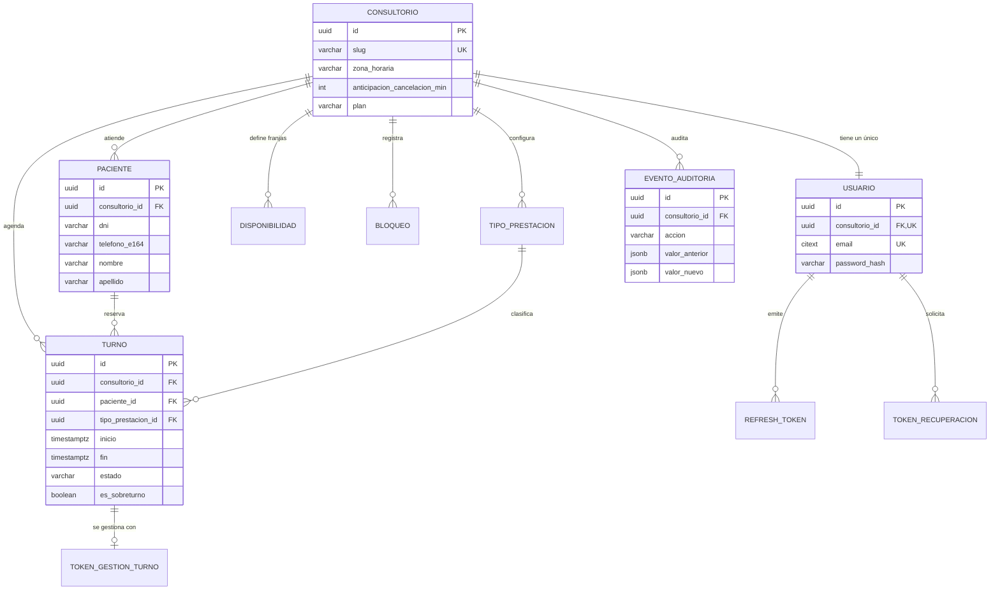

# Modelo de Datos

> Motor: PostgreSQL 16. Esquema versionado con Flyway ([DD-05](09_decisiones_y_supuestos.md)).
> Reglas que el modelo materializa: [05_reglas_de_negocio.md](05_reglas_de_negocio.md).

## Convenciones

- Nombres de tablas y columnas en `snake_case` y en español, en singular (`turno`, `paciente`).
- PK `id UUID` (generado en la aplicación, UUIDv7 para orden temporal). Sin IDs secuenciales expuestos.
- Instantes como `TIMESTAMPTZ` (se guardan en UTC). Horarios semanales como `TIME` locales a la zona
  horaria del consultorio.
- Toda tabla de negocio tiene `created_at` y, si es mutable, `updated_at`.
- **Aislamiento por tenant**: toda tabla, salvo `consultorio`, tiene `consultorio_id UUID NOT NULL`
  con FK a `consultorio(id)`. Las FKs entre entidades de negocio son **compuestas**
  `(consultorio_id, id)` para que sea imposible, a nivel de base, relacionar un turno con un paciente
  de otro consultorio. Todo índice de consulta empieza por `consultorio_id`.
- Los secretos (contraseñas, tokens) se guardan **solo como hash**.
- Enums como `VARCHAR` + `CHECK` (más simples de migrar que tipos `ENUM` de Postgres).

## Dominios

| Dominio (paquete) | Tablas | Descripción |
|-------------------|--------|-------------|
| `consultorio` | `consultorio`, `tipo_prestacion`, `disponibilidad` | Tenant y su configuración |
| `auth` | `usuario`, `refresh_token`, `token_recuperacion` | Cuenta del odontólogo (dominio CRITICAL) |
| `agenda` | `turno`, `bloqueo`, `paciente` | Núcleo de la agenda |
| `reserva` | `token_gestion_turno` | Acceso del paciente anónimo a su turno |
| `auditoria` | `evento_auditoria` | Registro append-only |
| `exportacion` | — (lee de todas) | Genera el ZIP; deja evento en auditoría |

## ERD



## Entidades

### Consultorio (tenant)
- `id UUID PK`, `nombre VARCHAR(120) NOT NULL`, `slug VARCHAR(40) UNIQUE NOT NULL`, `direccion VARCHAR(200)`, `telefono_contacto VARCHAR(20)` (E.164; se muestra al paciente cuando no puede cancelar online). Es nulo en la base porque el registro crea el consultorio sin teléfono, pero guardar la configuración lo exige ([RN-TE-06](05_reglas_de_negocio.md)).
- `zona_horaria VARCHAR(50) NOT NULL DEFAULT 'America/Argentina/Buenos_Aires'`.
- `anticipacion_cancelacion_min INT NOT NULL DEFAULT 1440` (24 h) — `CHECK (0..10080)`.
- `anticipacion_reserva_min INT NOT NULL DEFAULT 120`, `horizonte_reserva_dias INT NOT NULL DEFAULT 60`, `paso_huecos_min INT NOT NULL DEFAULT 15` (`CHECK IN (5,10,15,20,30)`).
  - La base exige `horizonte_reserva_dias > 0`; la aplicación además lo topea en **365 días** y exige `anticipacion_reserva_min < horizonte_reserva_dias × 1440` ([RN-TE-06](05_reglas_de_negocio.md), C-08).
- `reserva_publica_activa BOOLEAN NOT NULL DEFAULT true`.
- `plan VARCHAR(10) NOT NULL CHECK (plan IN ('PRUEBA','ACTIVO','VENCIDO'))`, `prueba_hasta DATE`.
- Constraint: `slug ~ '^([a-z0-9])(-?[a-z0-9])+$'`, palabras reservadas validadas en aplicación ([RN-TE-03](05_reglas_de_negocio.md)).

### Usuario (odontólogo)
- `id UUID PK`, `consultorio_id UUID UNIQUE NOT NULL FK` (relación 1:1 en v1), `email CITEXT UNIQUE NOT NULL`, `password_hash VARCHAR(100) NOT NULL` (BCrypt), `nombre`, `apellido`, `matricula VARCHAR(30) NULL`.
- `intentos_fallidos INT NOT NULL DEFAULT 0`, `bloqueado_hasta TIMESTAMPTZ NULL`, `password_cambiado_at TIMESTAMPTZ NOT NULL`.
- `credenciales_version INT NOT NULL DEFAULT 1`: viaja como claim `ver` del access token. Cambiar o recuperar la contraseña la incrementa y deja sin efecto los tokens anteriores ([RN-AU-05](05_reglas_de_negocio.md)).
- `terminos_version VARCHAR(40) NOT NULL` y `terminos_aceptados_at TIMESTAMPTZ NOT NULL`: versión de términos aceptada en el registro y cuándo (LG-04, [DD-23](09_decisiones_y_supuestos.md)).
- Sin `DELETE` para el rol de la aplicación (`REVOKE`): la cuenta se desactiva o se da de baja por soporte, nunca se borra desde la app ([PA-07](10_preguntas_abiertas.md)).
- Relaciones: 1:N `refresh_token`, 1:N `token_recuperacion`.

### RefreshToken / TokenRecuperacion
- `id`, `consultorio_id`, `usuario_id FK`, `token_hash CHAR(64) UNIQUE` (SHA-256 hex), `expira_at`, `revocado_at` / `usado_at`, `created_at`.
- Índice: `(usuario_id) WHERE revocado_at IS NULL`.

### TipoDePrestacion
- `id`, `consultorio_id`, `nombre VARCHAR(80)`, `duracion_min INT CHECK (duracion_min BETWEEN 5 AND 480 AND duracion_min % 5 = 0)`, `activa BOOLEAN DEFAULT true`, `visible_publica BOOLEAN DEFAULT true`, `orden INT`.
- Unique: `(consultorio_id, lower(nombre))`. No se borra si tiene turnos: se desactiva.

### Disponibilidad (franjas semanales)
- `id`, `consultorio_id`, `dia_semana SMALLINT CHECK (1..7)` (ISO, 1 = lunes), `hora_inicio TIME`, `hora_fin TIME`, `CHECK (hora_fin > hora_inicio)`, horas en múltiplos de 5 minutos (`ck_disponibilidad_multiplo_5`, [RN-AG-08](05_reglas_de_negocio.md)).
- Exclusión: no se solapan dos franjas del mismo día del mismo consultorio (`EXCLUDE USING gist (consultorio_id WITH =, dia_semana WITH =, tsrange(...) WITH &&)` sobre una fecha ancla).

### Bloqueo
- `id`, `consultorio_id`, `inicio TIMESTAMPTZ`, `fin TIMESTAMPTZ`, `motivo VARCHAR(120) NULL`, `created_at`. `CHECK (fin > inicio)`.
- Índice GiST: `(consultorio_id, tstzrange(inicio, fin))`.

### Paciente (datos mínimos)
- `id`, `consultorio_id`, `nombre VARCHAR(80)`, `apellido VARCHAR(80)`, `dni VARCHAR(8) NOT NULL` (solo dígitos, 7 u 8), `telefono_e164 VARCHAR(16) NOT NULL`, `email CITEXT NULL`, `origen VARCHAR(10) CHECK IN ('LINK','MANUAL')`, `requiere_revision BOOLEAN DEFAULT false`, `consentimiento_at TIMESTAMPTZ NULL`, `consentimiento_version VARCHAR(40) NULL` (como `usuario.terminos_version`; la versión vigente `2026-11-borrador` no entra en 10), `created_at`, `updated_at`.
- Unique: `(consultorio_id, dni)` — clave de deduplicación ([DD-24](09_decisiones_y_supuestos.md)). El teléfono es contacto obligatorio, no único.
- Sin datos clínicos en v1 (minimización, [11](11_marco_legal_argentino.md)).

### Turno
- `id`, `consultorio_id`, `paciente_id`, `tipo_prestacion_id`, `inicio TIMESTAMPTZ`, `fin TIMESTAMPTZ`, `duracion_min INT` (copia de la prestación al crear; editable por el odontólogo).
- `estado VARCHAR(12) CHECK IN ('RESERVADO','CONFIRMADO','CANCELADO','AUSENTE')`.
- `es_sobreturno BOOLEAN NOT NULL DEFAULT false` — el "sobreturno" del Discovery se modela como **marca**, no como estado, porque un sobreturno también se confirma, se cancela o queda ausente ([DD-10](09_decisiones_y_supuestos.md)).
- `origen VARCHAR(10) CHECK IN ('LINK','MANUAL')`, `cancelado_por VARCHAR(12) NULL` (`ODONTOLOGO`/`PACIENTE`), `motivo_cancelacion VARCHAR(200)`, `nota_interna VARCHAR(500)`, `version BIGINT` (optimistic locking), `created_at`, `updated_at`.
- Constraint clave ([RN-AG-01](05_reglas_de_negocio.md)):
  ```sql
  CREATE EXTENSION IF NOT EXISTS btree_gist;
  ALTER TABLE turno ADD CONSTRAINT ex_turno_sin_solapamiento
    EXCLUDE USING gist (consultorio_id WITH =, tstzrange(inicio, fin, '[)') WITH &&)
    WHERE (NOT es_sobreturno AND estado IN ('RESERVADO','CONFIRMADO'));
  ```
- Índices: `(consultorio_id, inicio)`, `(consultorio_id, paciente_id, inicio)`.
- CHECKs (C-10, `V6`): `ck_turno_duracion` (5 a 480, múltiplo de 5), `ck_turno_fin` (`fin = inicio + duracion_min`, comparando epochs), `ck_turno_grilla` (inicio en múltiplos de 5 minutos, `extract(epoch FROM inicio) % 300 = 0` en `numeric`), `ck_turno_estado`, `ck_turno_origen`, `ck_turno_sobreturno_manual` (`NOT es_sobreturno OR origen = 'MANUAL'`) y `ck_turno_cancelacion` (`cancelado_por` y `motivo_cancelacion` solo en un turno `CANCELADO`). FKs compuestas `fk_turno_paciente` y `fk_turno_tipo_prestacion`. Sin `DELETE` para el rol de la aplicación.

### TokenGestionTurno
- `id`, `consultorio_id`, `turno_id UNIQUE`, `token_hash CHAR(64) UNIQUE`, `expira_at` (= `fin` del turno), `revocado_at NULL`, `created_at`.
- El token en claro (256 bits, base64url) se devuelve **una sola vez** al reservar ([RN-RP-06](05_reglas_de_negocio.md)).

### EventoAuditoria (append-only)
- `id UUID`, `consultorio_id`, `ocurrido_at TIMESTAMPTZ DEFAULT now()`, `actor_tipo VARCHAR(12) CHECK IN ('ODONTOLOGO','PACIENTE','SISTEMA')`, `actor_id UUID NULL` (usuario o paciente), `entidad VARCHAR(30)`, `entidad_id UUID`, `accion VARCHAR(40)` (p. ej. `TURNO_CREADO`, `TURNO_REPROGRAMADO`, `TURNO_ESTADO_CAMBIADO`, `TURNO_DURACION_CAMBIADA`, `TURNO_NOTA_CAMBIADA`, `BLOQUEO_CREADO`, `BLOQUEO_ELIMINADO`, `PACIENTE_REVISADO`, `EXPORTACION_GENERADA`, `LOGIN_FALLIDO`, `PASSWORD_CAMBIADA`), `valor_anterior JSONB NULL`, `valor_nuevo JSONB NULL`, `ip INET NULL`.
- Inmutabilidad: trigger `BEFORE UPDATE OR DELETE` que lanza excepción, y el rol de base de la aplicación solo tiene `INSERT, SELECT` sobre la tabla ([RN-AD-02](05_reglas_de_negocio.md)).
- Índices: `(consultorio_id, ocurrido_at DESC)`, `(consultorio_id, entidad, entidad_id)`.

## Aislamiento por tenant (resumen)

| Capa | Mecanismo |
|------|-----------|
| Base de datos | `consultorio_id NOT NULL` + FKs compuestas `(consultorio_id, id)` en todas las tablas de negocio |
| Repositorios | Todos los métodos reciben `ConsultorioId` explícito; prohibidos `findById(id)` sin tenant (regla de ArchUnit, [08](08_arquitectura_propuesta.md)) |
| Seguridad | `consultorio_id` sale del claim `cid` del JWT o del `slug`/token en rutas públicas, nunca del body |
| Futuro | Row Level Security de Postgres como defensa en profundidad (backlog) |

## Seed data inicial

| Ámbito | Contenido | Mecanismo |
|--------|-----------|-----------|
| Todos los perfiles | Extensiones `btree_gist`, `citext`; trigger de inmutabilidad de auditoría | Migraciones versionadas `V1__...` |
| Producción | **Sin datos**: cada consultorio nace del registro | — |
| Perfil `local` / demo | Consultorio "Consultorio Demo" (slug `demo`); usuario `demo@consultorio.test` con contraseña definida en `backend/src/main/resources/db/seed-local/` (solo dev); prestaciones Consulta 30', Limpieza 45', Extracción 60', Control 20'; disponibilidad lun–vie 09:00–13:00 y 15:00–19:00; 5 pacientes ficticios y 10 turnos de la semana en curso, incluido 1 sobreturno y 1 bloqueo | Migraciones repetibles en `db/seed-local`, incluidas en `spring.flyway.locations` solo en perfil `local` |
| Tests | Fixtures construidas por builders en código (`TurnoMother`, `ConsultorioMother`), sin depender del seed | JUnit / Testcontainers |
