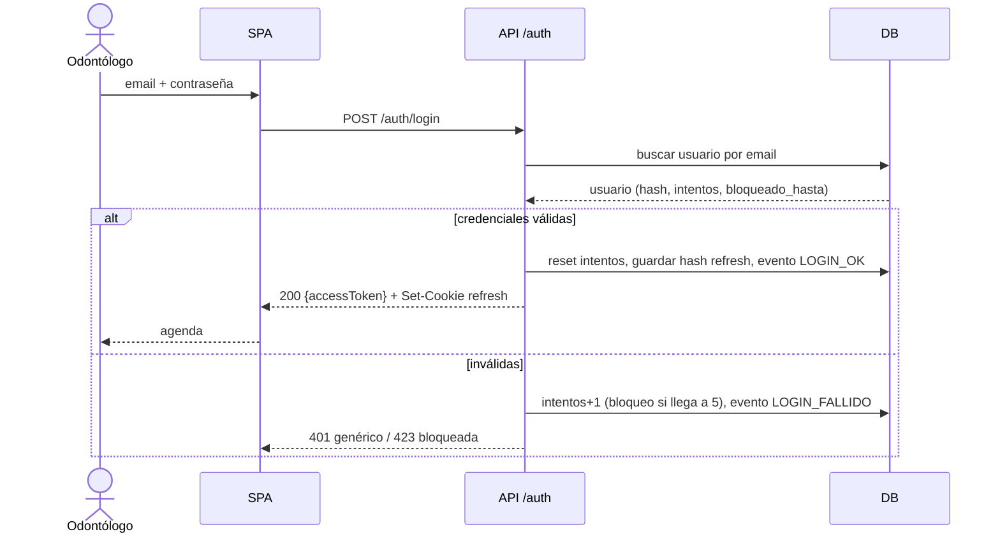
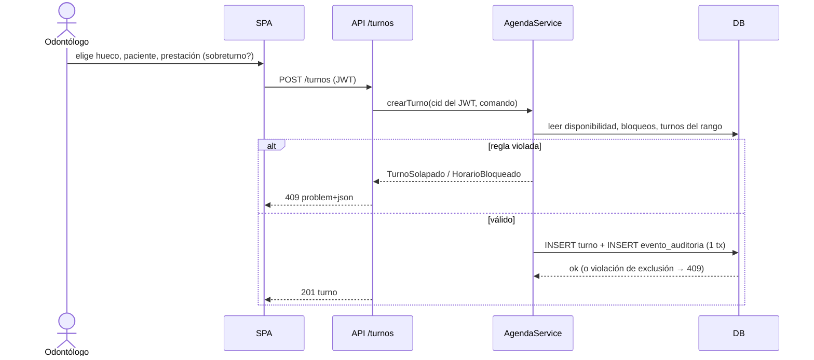
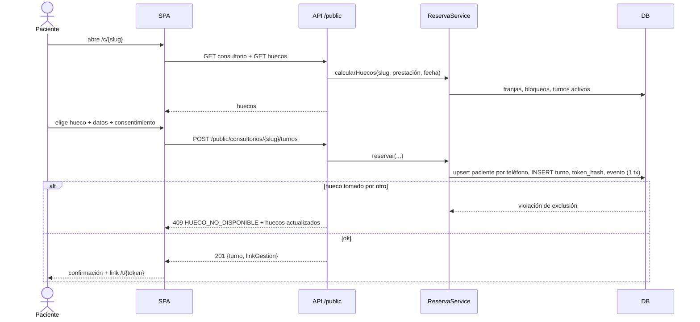
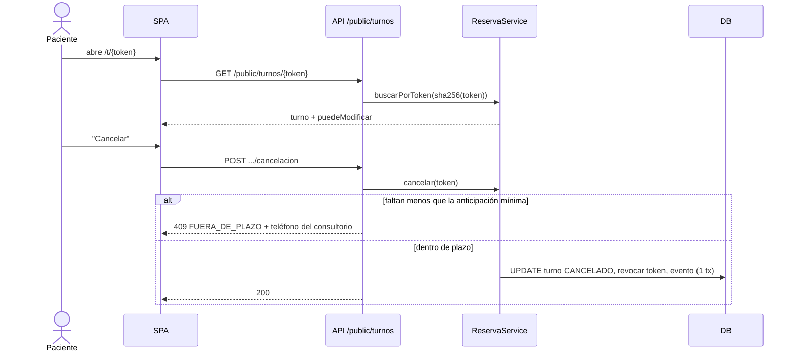

# Flujos Principales

Cada flujo se documenta extremo a extremo. Componentes: **SPA** (frontend Vite/PWA), **API**
(controladores Spring), **Svc** (servicios de aplicación del dominio), **DB** (PostgreSQL),
**Mail** (SMTP; Mailpit en local). Reglas citadas en [05](05_reglas_de_negocio.md).

## FL-01: Registro y login del odontólogo

**Disparador**: el visitante pulsa "Probar gratis" o "Ingresar". **Actor**: odontólogo.

**Pasos**:
1. SPA valida formato (email, largo de contraseña) y envía `POST /auth/registro`.
2. Svc `auth` verifica email único, hashea con BCrypt, crea `consultorio` (plan `PRUEBA`, slug sugerido) y `usuario` en una transacción; audita `CUENTA_CREADA`.
3. SPA redirige a login (o login automático) → `POST /auth/login`.
4. Svc valida credenciales y bloqueo, emite access JWT (`sub`, `cid`, `exp` 15 min) y refresh opaco (hash en DB, cookie `HttpOnly`).
5. SPA guarda el access token **en memoria** y navega a `/app/agenda` (o al asistente de configuración si no hay prestaciones).
6. Ante un 401, la SPA llama una vez a `POST /auth/refresh` y reintenta.

**Casos de error**: email en uso → 409; contraseña débil → 400; cuenta bloqueada → 423 con minutos restantes; refresh reutilizado → revocación total y 401 ([RN-AU-02](05_reglas_de_negocio.md)).

**Recuperación de contraseña** (variante): `POST /auth/recuperacion` → si existe, se guarda hash de token y se envía email por SMTP → `POST /auth/recuperacion/confirmar` con token + nueva contraseña → revoca refresh tokens. Respuesta siempre 202 ([RN-AU-04](05_reglas_de_negocio.md)).

## FL-02: Configurar disponibilidad y prestaciones (onboarding)

**Disparador**: primer login sin prestaciones. **Actor**: odontólogo.

**Pasos**:
1. Paso 1 — Consultorio: confirma nombre, slug, teléfono de contacto, anticipación mínima → `PUT /consultorio`.
2. Paso 2 — Prestaciones: carga al menos una (nombre + duración) → `POST /prestaciones` por cada una.
3. Paso 3 — Disponibilidad: grilla semanal con franjas → `PUT /disponibilidad` (reemplazo completo, valida no-solapamiento por día).
4. Paso 4 — Compartir: la SPA muestra el link `/c/{slug}` con botones copiar/compartir (Web Share API).
5. Cada paso audita el cambio de configuración ([RN-AD-04](05_reglas_de_negocio.md)).

**Casos de error**: slug tomado → 409 con sugerencias; franjas solapadas → 400 `FRANJAS_SOLAPADAS`; duración inválida → 400.

## FL-03: El odontólogo crea un turno, un sobreturno o un bloqueo

**Disparador**: toque en un hueco de la agenda o botón "+". **Actor**: odontólogo.

**Pasos**:
1. SPA abre el formulario: paciente (búsqueda por nombre/teléfono o alta rápida), prestación, inicio, checkbox **"Sobreturno"**.
2. `POST /turnos` con `{pacienteId | pacienteNuevo, prestacionId, inicio, duracionMin?, esSobreturno}`.
3. Svc `agenda` calcula `fin`, valida disponibilidad y bloqueos ([RN-AG-03/04](05_reglas_de_negocio.md)) y solapamiento si no es sobreturno ([RN-AG-01](05_reglas_de_negocio.md)).
4. Inserta el turno; la restricción de exclusión actúa como red de seguridad ante carreras; escribe `TURNO_CREADO` en la misma transacción.
5. SPA refresca la vista con `GET /agenda?desde&hasta`.

**Bloqueo**: `POST /bloqueos {inicio, fin, motivo}` → Svc busca turnos activos en el rango → si hay, 409 `BLOQUEO_CON_TURNOS` con la lista ([RN-AG-05](05_reglas_de_negocio.md)); si no, inserta y audita.

**Casos de error**: solapamiento → 409 `TURNO_SOLAPADO`; fuera de disponibilidad sin sobreturno → 409 `FUERA_DE_DISPONIBILIDAD` (la SPA ofrece "crear como sobreturno"); dentro de bloqueo → 409 `HORARIO_BLOQUEADO`; plan vencido → 403 `PLAN_VENCIDO`.

## FL-04: El paciente reserva por link

**Disparador**: el paciente abre `/c/{slug}` desde un link compartido. **Actor**: paciente anónimo.

**Pasos**:
1. SPA → `GET /public/consultorios/{slug}`: nombre, dirección, prestaciones visibles.
2. Paciente elige prestación y día → `GET /public/consultorios/{slug}/huecos?prestacionId&fecha`.
3. Svc `reserva` calcula huecos = franjas del día − bloqueos − turnos activos (incl. sobreturnos), en pasos de `paso_huecos_min`, dentro de `[ahora + anticipación de reserva, ahora + horizonte]` ([RN-RP-01](05_reglas_de_negocio.md)).
4. Paciente elige hueco, completa nombre, apellido, teléfono (email opcional) y acepta la política de privacidad.
5. `POST /public/consultorios/{slug}/turnos`. Svc normaliza teléfono a E.164, deduplica paciente ([RN-RP-03](05_reglas_de_negocio.md)), verifica límite de turnos futuros, revalida el hueco, inserta turno + token de gestión (hash) + evento, todo en una transacción.
6. API devuelve el token en claro **una vez**; la SPA muestra la confirmación con el link `/t/{token}`, botón copiar, "agregar al calendario" (archivo `.ics` generado en el cliente) y aviso de que lo guarde.

**Casos de error**: slug inexistente → 404; reserva pública desactivada o plan vencido → 200 con `tomaTurnosOnline = false` y teléfono ([RN-RP-11](05_reglas_de_negocio.md)); hueco tomado → 409; límite por teléfono → 409 `LIMITE_TURNOS`; rate limit → 429.

## FL-05: El paciente reprograma o cancela con anticipación mínima

**Disparador**: el paciente abre `/t/{token}`. **Actor**: paciente anónimo.

**Pasos**:
1. SPA → `GET /public/turnos/{token}`: Svc hashea el token, busca `token_gestion_turno` vigente y devuelve turno, consultorio y si `puedeModificar` (= `ahora ≤ inicio − anticipación`).
2. **Cancelar**: `POST /public/turnos/{token}/cancelacion` → revalida plazo ([RN-RP-04](05_reglas_de_negocio.md)) → estado `CANCELADO`, `cancelado_por = PACIENTE`, revoca token, audita.
3. **Reprogramar**: la SPA pide huecos de la misma prestación → `POST /public/turnos/{token}/reprogramacion {nuevoInicio}` → revalida plazo sobre el horario **actual** y hueco ofrecible sobre el nuevo → actualiza `inicio/fin` con optimistic locking → audita `TURNO_REPROGRAMADO` con horario anterior.

**Casos de error**: token inválido/vencido/revocado → 404 genérico; fuera de plazo → 409 `FUERA_DE_PLAZO`; nuevo hueco tomado → 409 y el turno conserva su horario ([RN-RP-05](05_reglas_de_negocio.md)); turno ya cancelado por el odontólogo → 404.

## FL-06: Exportación completa de datos

**Disparador**: botón "Exportar mis datos" en `/app/exportar`. **Actor**: odontólogo.

**Pasos**:
1. SPA → `GET /exportacion` (JWT).
2. Svc `exportacion` verifica el límite de 1 cada 5 min ([RN-EX-04](05_reglas_de_negocio.md)) y abre una transacción `READ ONLY` con aislamiento `REPEATABLE READ` para obtener una foto consistente.
3. Recorre cada entidad del tenant en streaming y escribe en un `ZipOutputStream` hacia la respuesta: `{entidad}.json`, `{entidad}.csv` y `manifest.json`. Excluye secretos ([RN-EX-02](05_reglas_de_negocio.md)).
4. Registra `EXPORTACION_GENERADA` (en transacción separada, ya que la principal es de solo lectura).
5. El navegador descarga `export-{slug}-{fecha}.zip`.

**Casos de error**: límite excedido → 429 con `Retry-After`; error a mitad del streaming → se corta la descarga y el evento no se registra; se reintenta manualmente.

## FL-07: Vencimiento de la prueba (tarea del sistema)

**Disparador**: tarea `@Scheduled` diaria a las 03:00 (hora del servidor). **Actor**: sistema.

**Pasos**: selecciona consultorios con `plan = PRUEBA` y `prueba_hasta < hoy` → pasa a `VENCIDO` → audita `PLAN_VENCIDO` con `actor_tipo = SISTEMA` ([RN-PL-03](05_reglas_de_negocio.md)). Es idempotente: correrla dos veces no genera eventos duplicados.
